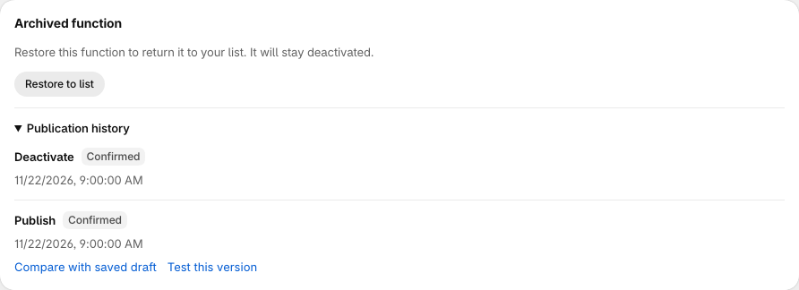

# Functions

Functions let you change what happens while a customer shops. Give a shopper three T-shirts for $30, split a two-pack into the items you’ll ship, or ask for a gift message before checkout. You can build and test a rule in Mechanic without writing code.

In the builder, you choose the conditions to check and what should happen when they match. Shopify runs the published rule with the cart and checkout data it supplies. Use a [task](tasks/README.md) for work that responds to an event or a schedule, such as tagging the resulting order, emailing a customer, or sending fulfillment details to another service. Checkout does not wait for a task or its actions.


Functions are available in a limited pilot. The Mechanic team enables creation for individual shops. If your shop leaves the pilot while a rule is live, you can still open the rule and deactivate it.


## What can a function do?

| Function type | Example |
| --- | --- |
| Discount | Offer three eligible T-shirts for $30 when they would otherwise cost more. Discounts can apply to items, an order, or shipping. |
| Cart and checkout validation | When the cart mixes products tagged `preorder` with regular items, block checkout and ask the buyer to order them separately. |
| Cart Transform | Expand a two-pack into a black shirt and a white shirt, or merge matching cart lines into a kit. |
| Delivery customization | Hide express shipping for items that need extra preparation time. |
| Payment customization | Show “Bank deposit” as “Wholesale transfer” and move it to the top of the list for wholesale buyers. |

A merged kit costs the sum of its components. Use one-time purchases for bundles. Shopify rejects bundle operations on lines with a selling plan. [Shopify’s Cart Transform limits](https://shopify.dev/docs/api/functions/latest/cart-transform#invalid-scenarios)

Delivery and payment rules can hide, rename, or reorder options Shopify already offers. In the rule, enter the full option name Shopify supplies to the Function, including capitalization and parentheses. A payment method’s name can differ from its label in checkout. Try the rule in your shop’s checkout because Shopify restricts which payment methods can be changed by plan, region, and checkout type. [Shopify’s payment customization restrictions](https://shopify.dev/docs/api/functions/latest/payment-customization#plan-and-geographical-restrictions)

## Try a discount with a test cart

Choose **Create function** to start from a blank rule or a starting point. Use the **Test cart** to check which items qualify and what the buyer pays. For a first walkthrough, [offer three items for $30](../resources/tutorials/offer-three-items-for-30.md).

A rule can have up to 12 paths and 20 saved test carts. If a rule has several paths, the first path whose conditions match decides the outcome. If that path gives a discount on an item that is missing from the cart, the buyer gets no discount and later paths are skipped. To allow a later offer in that situation, add **Cart contains an item** to the first path and select the reward item.

For a different offer, open **Every second item half price**. One $18 shirt stays at $18. Add a $14 shirt and the pair costs $25. With two of each, both $14 shirts get the discount.

To try real items, choose **Try with my products** in the test cart. You can choose variants and test their selling prices before granting permission to publish. If the rule needs collection membership, product metafields, or other details the picker didn’t supply, Mechanic explains which product data it needs. You can keep testing with a sample cart.

If every item is a one-time variant from your shop, **Open in storefront** opens those items and quantities in a new tab. For a code discount, the link also carries the code you entered in the test cart. If the code contains a comma, enter it at checkout. The storefront uses published rules. Values you entered in the tester, such as customer tags, stay in the builder.

### Choose what shoppers see at checkout

For an automatic discount, enter a **Label shown to shoppers** under **Discount settings**. You can keep a descriptive Function name for your team and show buyers a shorter label, such as “Bundle savings”. Leaving the label blank uses the Function name.

To give one path its own label, open its **Then** step and choose **Customize label for this outcome**. When the discount applies, the test cart shows the matching path’s label beside the savings. A path with no override uses the discount’s default label. Code discounts show the code the buyer entered.

## Offer a discount in store

To offer three T-shirts for $30 at the register, open **Discount settings** and set **Eligible checkouts** to **Shopify POS only**. The same three shirts now cost $30 in POS and $50 in a checkout outside POS. This setting covers every path in the rule.

Choose **Specific POS locations** to run the offer at selected stores. Enter one location name per line, exactly as it appears in **Settings → Locations** in Shopify. Mechanic checks the names against active Shopify locations when you publish. Update the rule if you rename a location or import it into another shop. To run the offer everywhere Shopify supports it except at the register, choose **Exclude Shopify POS**.

<figure><figcaption>
Enter Downtown to offer the discount at that register.
</figcaption></figure>

In **Test cart**, choose **Edit cart** and change **Test checkout**. For a location-specific offer, try a listed location and an unlisted one. Shopify requires POS Pro at a location for automatic discounts. [Discounts in Shopify POS](https://help.shopify.com/en/manual/sell-in-person/shopify-pos/discount-management)

## Publish your rule

**Save draft** keeps your work in Mechanic. If an earlier version of the rule is live, shoppers continue to get that version.

Some starting points apply to all items. For an offer such as **Three items for $30**, choose the eligible collection from your shop before publishing. For an item discount, choose **Edit** beside **Discounted items** on the relevant path, select the variant or collection, and save the draft. If any are missing during review, choose **Choose missing resources**.

If your saved rule needs more Shopify access, choose **Review Shopify permissions** above the test cart. You can keep testing while access is pending.

To see why Mechanic needs a permission, open **Settings → Permissions** in Mechanic. Each required permission links to the saved Functions that use it. For example, a discount appears under `write_discounts`. A condition based on the buyer’s previous order count uses data Shopify supplies to the Function during checkout.

When you’re ready, open **Live checkout** and choose **Publish saved version**. Review what each path will do, then choose **Confirm publish**. Wait for Shopify’s confirmation. If Mechanic says the rule is too complex to publish, simplify the conditions or reuse the same item filters across paths, then check the test carts again. If the change is still awaiting confirmation, use **Check publication again**. For a scheduled discount, its start and end dates determine when shoppers can receive it.

## Check what shoppers are getting

If checkout gives a different result than your draft, choose **Test published version** under **Live checkout**. It runs the same test cart against the last confirmed rule. While Shopify is confirming a change, this button reads **Test last confirmed version**.

When you open a published discount, validation, delivery, or payment function, Mechanic asks Shopify whether it has recorded a checkout error. **Live checkout** shows when Mechanic checked. If Shopify reports an error, you’ll see when it was first recorded for that function type. If the check is unavailable, you can still test the published version.

For Cart Transform, or to share logs for a reported error, go to **Settings → Apps** in Shopify admin, select **Mechanic**, and open **Functions**. When Shopify offers **Share logs**, you can send the previous 24 hours of activity to Mechanic support. Individual live runs are visible to developers in Shopify’s Dev Dashboard. [Shopify’s guide to sharing Function logs](https://help.shopify.com/en/manual/apps/managing-apps#share-function-logs)

## What happens if your subscription lapses?

When Mechanic suspends your shop for billing, it pauses your published Functions. Checkout can continue applying a rule until Shopify confirms the pause. Discount codes, schedules, and usage history are preserved.

When your subscription becomes active again, Mechanic automatically restores the last published version of each eligible Function it paused for billing. Rules you deactivated, archived Functions, and expired discounts stay off. Unpublished edits stay in the draft. You can check the pause and restore in the Function’s publication history.

## Deactivate, archive, or delete a function

A shop can keep up to 100 Functions in **Current**, across all five types. Drafts, live rules, and deactivated rules each use one slot. Archiving a deactivated rule frees its slot and keeps its history. Restoring it uses a slot again.

Shopify also limits how many Functions can be active at once. Across all apps on your store, you can have up to 25 [discount Functions](https://shopify.dev/docs/api/functions/latest/discount) and up to 25 each of [cart and checkout validations, delivery customizations, and payment customizations](https://shopify.dev/changelog/posts/shopify-functions-25-functions-limit). Each app can have one active [Cart Transform](https://shopify.dev/docs/api/functions/latest/cart-transform) per store, so you can publish one through Mechanic.

To stop a live rule, open **Live checkout**, choose **Deactivate**, and confirm. Once Shopify confirms, choose **Archive function** to remove it from **Current**. You can open it under **Functions → Archived** to see its publication history or test an earlier published version. **Restore to list** returns it to **Current** as inactive. Publishing it again is a separate step.

<figure></figure>

If a saved draft has never had a publication attempt, you can delete it and its saved test carts. Save or discard pending edits, then choose **Function actions → Delete draft**.

## Use a rule in another shop

To reuse a rule in another shop, choose **Function actions → Export JSON**, then **Import function** in the destination shop. Select that shop’s products and collections, test the imported draft, and publish it when ready.

## Connect a form and a function

A form can collect a gift message on the cart page, a function can require it for gift-wrapped items at checkout, and a task can email it after fulfillment. Follow the [gift-wrap checkout tutorial](../resources/tutorials/require-a-gift-message-for-wrapped-items.md) to connect all three.

You can also [write a Function with your AI assistant](../resources/tutorials/write-a-function-with-ai.md) and review its test carts in the builder.
