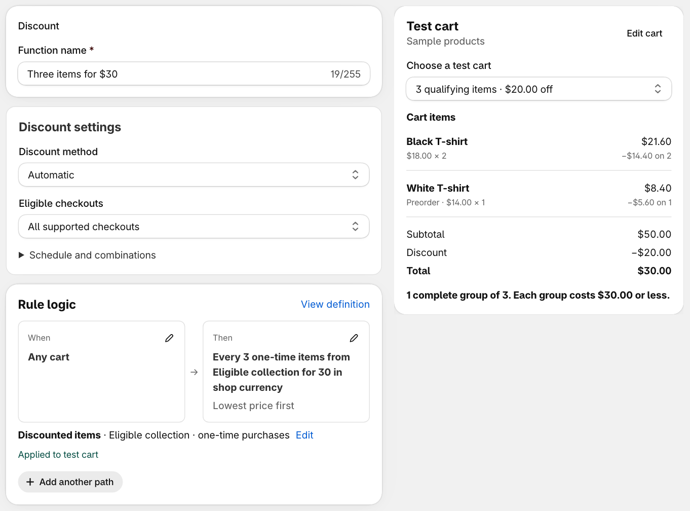
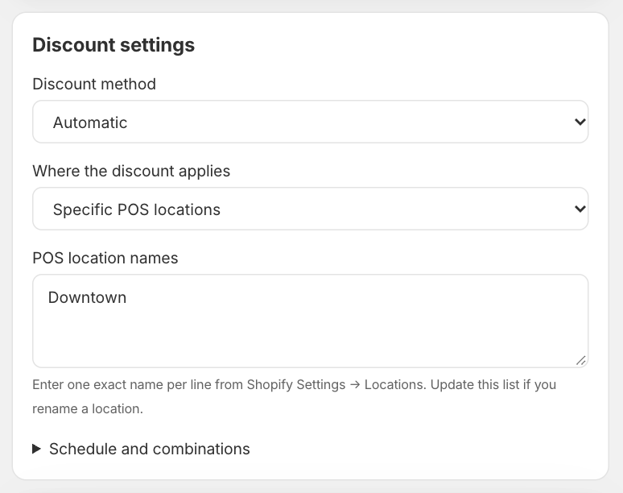
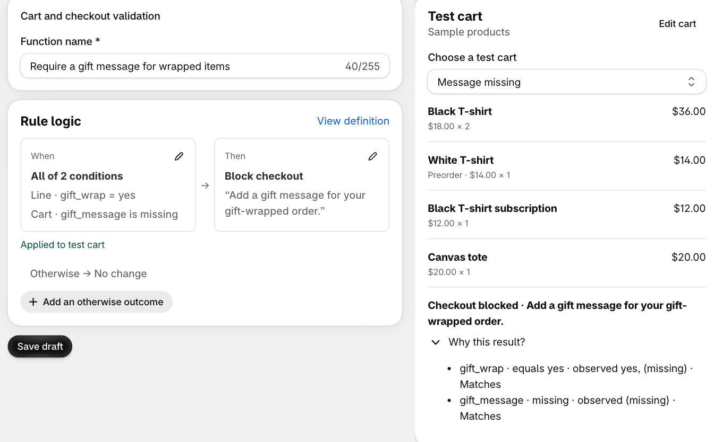

# Functions

Functions let you change what happens while a customer shops. Give a shopper three T-shirts for $30, split a two-pack into the items you’ll ship, or ask for a gift message before checkout. You can build and test a rule in Mechanic without writing code.

Use a [task](tasks/README.md) when you want to respond to an event, such as sending an email after an order is fulfilled.


Functions are in development for a limited pilot. The Mechanic team enables new function creation for individual pilot shops.


## What can a function do?

| Function type | Example |
| --- | --- |
| Discount | Sell any three eligible T-shirts for $30. Discounts can apply to items, an order, or shipping. |
| Cart and checkout validation | Ask a buyer to place separate orders for preorder and regular items, and show them what to change. |
| Cart Transform | Sell a T-shirt two-pack and show the black shirt and the white shirt as separate items in the order. |
| Delivery customization | Hide express shipping for items that need extra preparation time. |
| Payment customization | Rename a manual payment method so buyers recognize it, or change where it appears among eligible methods. |

For a merged bundle, the kit costs the sum of its components. For a delivery or payment rule, copy the full option name from the buyer’s checkout, including capitalization and any text in parentheses.

## Try a discount with a test cart

Open **Functions** in Mechanic. If you already have functions, choose **Create function**. Open **Three T-shirts for $30** under **Featured starting points**. To build your own discount, choose **Give a discount** and select **Create blank rule**.

<figure><figcaption>
Choose a type to start from scratch, or start with a rule you can edit.
</figcaption></figure>

In **Test cart**, choose **3 qualifying T-shirts**. The two black shirts cost $18 each and the white shirt costs $14. Together they would cost $50. The rule takes $20 off, bringing the total to $30.

If a rule has several paths, the first path whose conditions match decides the outcome. If that path gives a discount on an item that is missing from the cart, the buyer gets no discount and later paths are skipped. To allow a later offer in that situation, add **Cart contains an item** to the first path and select the reward item.

Switch to **2 qualifying T-shirts**. One black shirt and one white shirt cost $32. The buyer pays $32 because the offer needs a complete group of three. You can save either cart with its expected result and check it again after changing the rule.

<figure><figcaption>
Only complete groups get the offer. A fourth eligible shirt keeps its regular price.
</figcaption></figure>

For a different offer, open **Every second T-shirt half price**. One $18 shirt stays at $18. Add a $14 shirt and the pair costs $25. With two of each, both $14 shirts get the discount.

To try real items, choose **Try with my products** in the test cart. You can choose variants and test their selling prices before granting permission to publish. If the rule needs collection membership, product metafields, or other details the picker didn’t supply, Mechanic explains which product data it needs. You can keep testing with a sample cart.

If every item is a one-time variant from your shop, **Open in storefront** opens those items and quantities in a new tab. For a code discount, the link also carries the code you entered in the test cart. If the code contains a comma, enter it at checkout. The storefront uses published rules. Values you entered in the tester, such as customer tags, stay in the builder.

## Offer a discount in store

To offer three T-shirts for $30 at the register, open **Discount settings** and set **Eligible checkouts** to **Shopify POS only**. The same three shirts now cost $30 in POS and $50 in a checkout outside POS. This setting covers every path in the rule.

Choose **Specific POS locations** to run the offer at selected stores. Enter one location name per line, exactly as it appears in **Settings → Locations** in Shopify. Mechanic checks the names against active Shopify locations when you publish. Update the rule if you rename a location or import it into another shop. To run the offer everywhere Shopify supports it except at the register, choose **Exclude Shopify POS**.

<figure><figcaption>
Enter Downtown to offer the discount at that register.
</figcaption></figure>

In **Test cart**, choose **Edit cart** and change **Test checkout**. For a location-specific offer, try a listed location and an unlisted one. Shopify requires POS Pro at a location for automatic discounts. [Discounts in Shopify POS](https://help.shopify.com/en/manual/sell-in-person/shopify-pos/discount-management)

## Publish your rule

**Save draft** keeps your work in Mechanic. If an earlier version of the rule is live, shoppers continue to get that version.

Before publishing a starter, choose the products or collections it should use in your shop. For an item discount, choose **Edit** beside **Discounted items** on the relevant path, select the variant or collection, and save the draft. If any are missing during review, choose **Choose missing resources**.

If your saved rule needs more Shopify access, choose **Review Shopify permissions** above the test cart. You can keep testing while access is pending.

When you’re ready, open **Live checkout** and choose **Publish saved version**. Review what each path will do, then choose **Confirm publish**. Wait for Shopify’s confirmation. If the change is still awaiting confirmation, use **Check publication again**. For a scheduled discount, its start and end dates determine when shoppers can receive it.

## Check what shoppers are getting

If checkout gives a different result than your draft, choose **Test published version** under **Live checkout**. It runs the same test cart against the last confirmed rule. While Shopify is confirming a change, this button reads **Test last confirmed version**.

To stop using a live rule, choose **Deactivate** and confirm. For a saved draft that has never had a publication attempt, open **Function actions** and choose **Delete draft**.

To reuse a rule in another shop, choose **Function actions → Export JSON**, then **Import function** in the destination shop. Select that shop’s products and collections, test the imported draft, and publish it when ready.

## Connect a form and a function

If you offer gift wrapping, a form can collect the gift message, a function can ask for it before checkout, and a task can email it after fulfillment. [Set up the gift message form and email task](../resources/tutorials/add-a-gift-message-form-to-your-shopify-theme.md).

The **Require a gift message for wrapped items** starter checks that an item has the line item property `gift_wrap` set to `yes` and that the cart attribute `gift_message` is missing. Try **Message missing** and **Message added**. Open **Why this result?** to see which conditions matched.

<figure><figcaption>
The buyer sees this message only when an item is gift-wrapped and the cart has no gift note.
</figcaption></figure>

Before publishing, use your theme’s gift-wrap property and the actual key for the message. For a saved Mechanic cart form, choose **Try form**, fill in its required fields, and choose **View sample cart attributes**. Copy the full message key into the function’s cart attribute condition. Use **Edit cart** to test the same keys your shop will send.
