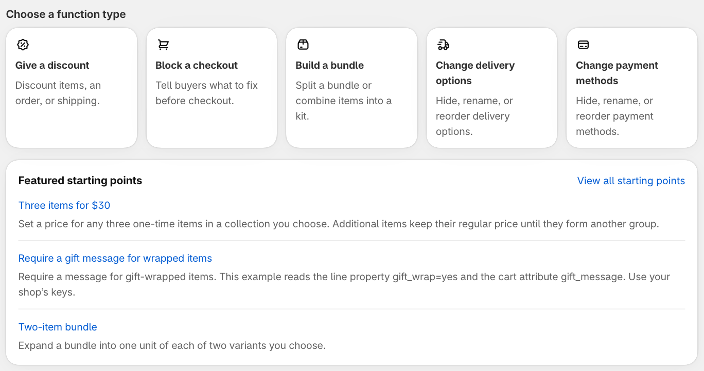
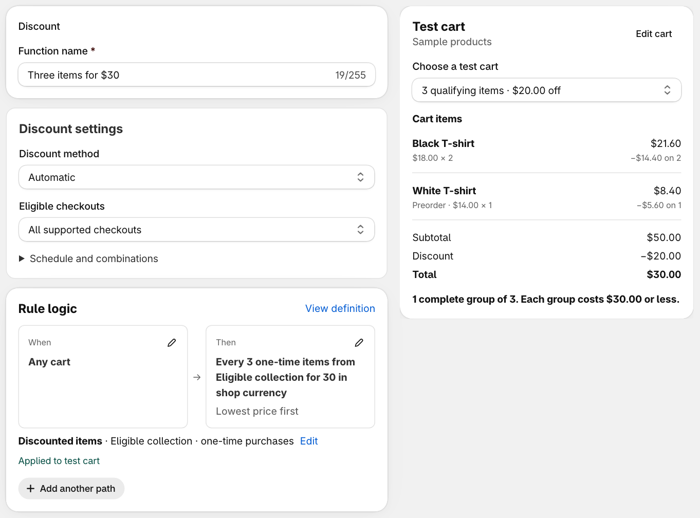

# Offer three items for $30

Suppose you want shoppers to mix and match three T-shirts for $30. You can try the offer with the sample shirts first, then choose the collection that qualifies in your shop. You’ll need access to the [Functions pilot](../../core/functions.md) to follow along.

## 1. Open the starting point

In Mechanic, open **Functions**. If you already have functions, choose **Create function**. Under **Featured starting points**, choose **Three items for $30**. Give the draft a name you’ll recognize.

<figure></figure>

## 2. Check both sides of the offer

In **Test cart**, choose **3 qualifying items**. Two black shirts at $18 each and a white shirt at $14 would usually cost $50. Look for a $20 discount and a $30 total.

Switch to **2 qualifying items**. One black shirt and one white shirt cost $32. The discount should be zero because the shopper hasn’t chosen a complete group of three. You can save both test carts with their expected results and run them again after editing the rule.

<figure></figure>

## 3. Choose what qualifies in your shop

Under **Rule logic**, edit **Discounted items** and choose your own eligible collection. The sample shirts let you try the math before making this choice. Choose **Save draft**.

Choose **Try with my products** to test variants from your shop. Try three eligible shirts, then replace one with an item outside the collection. Only the cart with three qualifying shirts should get the group price.

## 4. Publish when you want shoppers to receive the offer

Under **Live checkout**, choose **Publish saved version**, review the offer, and choose **Confirm publish**. If Mechanic requests access, review the Shopify permissions above the test cart first.

Once Shopify confirms, use **Open in storefront** with a test cart of one-time variants from your shop to check the published offer. To end it, choose **Deactivate** under **Live checkout**. See [publishing and managing functions](../../core/functions.md#publish-your-rule).
