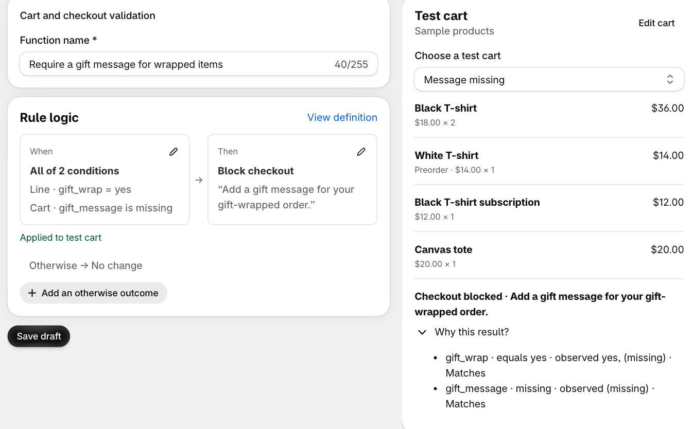

# Require a gift message for wrapped items

A shopper buying a gift-wrapped shirt should have a chance to write a note. Someone buying a regular shirt should be able to check out immediately. This walkthrough adds that checkout rule to a gift message form. You can also send the note to the recipient after fulfillment.

You’ll need access to the [Functions pilot](../../core/functions.md). To use the rule on your storefront, your theme must already identify gift-wrapped items with a line item property, and shoppers need a way to reach the form from their cart.

## 1. Find the two values your rule will check

Follow the [gift form setup](add-a-gift-message-form-to-your-shopify-theme.md#1-create-the-gift-form) to create the form, turn on cart saving, and place it on your cart page. In the saved form, choose **Try form**, fill in the required fields, and choose **View sample cart attributes**. Copy the full cart attribute key for the gift message.

Find the line item property and value your theme sets when the shopper chooses gift wrapping. The starter uses `gift_wrap` with the value `yes`. The form saves the note for the whole cart. Your theme supplies the marker on the wrapped item.

## 2. Try the checkout rule

In **Functions**, choose **Create function** if you already have functions. Open **Require a gift message for wrapped items** from the starting points.

In **Test cart**, choose **Message missing**. The sample cart contains a wrapped item, so the rule asks the buyer to add a gift message. Choose **Message added**. With the note present, the buyer can continue. Open **Why this result?** to see which conditions matched.

<figure></figure>

## 3. Match the rule to your storefront

Under **Rule logic**, edit the two conditions. Set the line item property and value to the ones your theme uses. Replace the sample cart attribute key `gift_message` with the full key you copied from your form. Keep the condition that checks whether the message is missing.

Choose **Edit cart** to test with those same keys. Try these three carts before publishing:

| Gift wrapping | Gift message | Expected checkout result |
| --- | --- | --- |
| Selected | Empty | Ask the buyer to add a message |
| Selected | Filled in | Allow checkout |
| No wrapped items | Empty | Allow checkout |

## 4. Try it as a shopper

Save the draft. When you’re ready for the rule to take effect, [publish the saved version](../../core/functions.md#publish-your-rule). In your storefront, add a gift-wrapped item and try checking out without a note. Then return to the cart, fill in the gift form, and check that you can continue.

If you also want to email the note, [add the matching email task](add-a-gift-message-form-to-your-shopify-theme.md#4-add-the-matching-email-task). The task sends the email when Shopify marks the whole order fulfilled.
